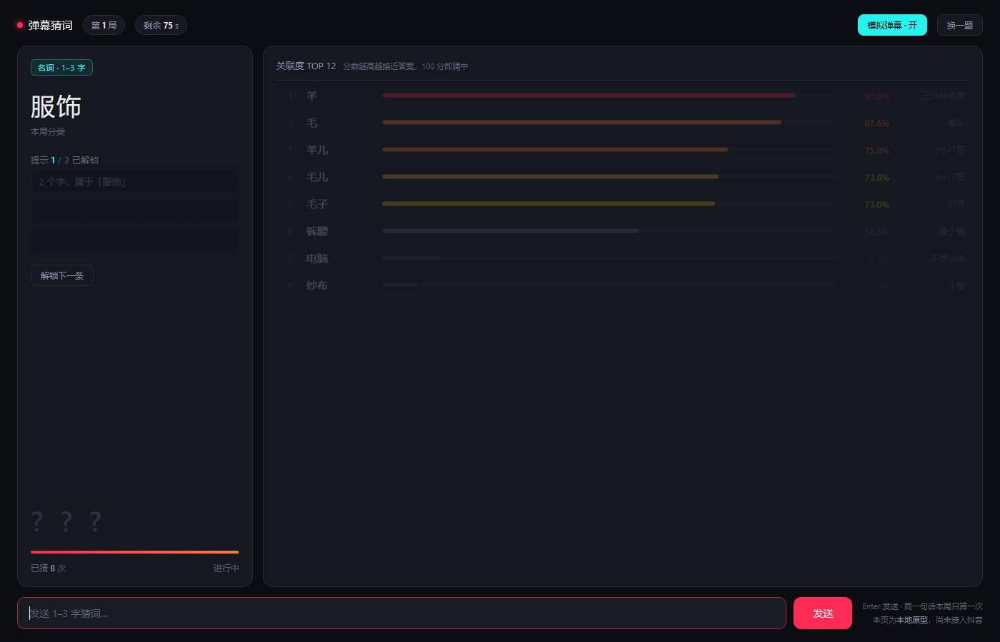

# 弹幕猜词 · 本地原型

抖音直播间「弹幕猜词」玩法的自建版本。当前是**阶段 0：本地可玩**——不接抖音，用模拟弹幕验证「关联度算法 + 交互节奏 + 叠层画面」是否成立。

零 npm 依赖，只用 Node 内置模块。



---

## 30 秒跑起来

```bash
cd 弹幕猜词   # 换成你的实际目录
node server.mjs
```

浏览器打开 <http://127.0.0.1:8830>

你会看到一个模拟的直播间叠层页面：

- 左边是题卡（分类、提示、倒计时）
- 右边是实时关联度榜单
- 底部输入框可以自己猜词，回车即算分
- 默认开着「模拟弹幕」，机器人每 1.8 秒发一条，看起来像真直播间

---

## 现在能做什么

| 能力 | 状态 |
|---|---|
| 关联度打分（同词同分、可解释） | ✅ |
| 实时榜单（SSE 推送，同词去重） | ✅ |
| 分档提示（3 条，逐条解锁） | ✅ 用按钮模拟「送礼解锁」 |
| 倒计时、换题、猜中自动进下一局 | ✅ |
| 模拟弹幕（本地无人也能看效果） | ✅ |
| 接真实抖音弹幕 | ❌ 待做，见 `docs/02-操作手册.md` |
| OBS 浏览器源叠层 | ❌ 待做，同上 |
| 礼物 → 换次数/换提示 的真实联动 | ❌ 待做 |

---

## 目录结构

```
弹幕猜词/
├─ server.mjs              HTTP + SSE + 游戏状态机（零依赖）
├─ ingest.mjs              弹幕桥接器：把抓到的弹幕灌进本地服务
├─ lib/
│  ├─ lexicon.mjs          语义图谱：4 个分类 / 19 个语义簇 / 约 155 个可出题词
│  └─ score.mjs            关联度打分引擎
├─ public/
│  └─ index.html           直播间风格前端（暗色，带 OBS 叠层模式）
├─ tools/
│  ├─ collect.mjs          采集器：弹幕原样存成 JSONL
│  ├─ analyze.mjs          分析器：JSONL → 竞品分析报告
│  └─ sample.mjs           生成合成样例数据（仅验证管线用）
├─ data/                  采集产物与报告（已 gitignore）
├─ docs/
│  ├─ 01-调研与商业拆解.md   这个玩法怎么赚钱、技术路线怎么选
│  ├─ 02-操作手册.md        从本地版到真开播的分阶段操作步骤
│  ├─ 03-关联度算法.md     打分逻辑，以及怎么换成 embedding / LLM
│  └─ 04-抓竞品数据.md     怎么采数据、怎么读报告、采完怎么决策
└─ package.json
```

---

## 数据管线（先验证再开发）

```bash
# 1) 管线自检（用合成数据，5 分钟）
node tools/sample.mjs
node tools/analyze.mjs --out data/report-sample.md

# 2) 采真实数据（需要先跑起抓取工具，见 docs/02）
node tools/collect.mjs ws ws://127.0.0.1:8888 --room 745964462470

# 3) 出报告
node tools/analyze.mjs
```

详见 `docs/04-抓竞品数据.md`。

---

## OBS 叠层模式

加 `?overlay=1` 就是直播用的透明背景版本：

```
http://127.0.0.1:8830/?overlay=1
```

背景透明、隐藏输入框和按钮，可以直接作为 OBS 浏览器源 / 直播伴侣窗口捕获。

---

## 可调参数

用环境变量控制，不用改代码：

```bash
PORT=8830 node server.mjs        # 端口
ROUND_MS=60000 node server.mjs   # 单局时长（毫秒），默认 90000
BOT_MS=3000 node server.mjs      # 模拟弹幕间隔（毫秒），默认 1800
```

窗口里右上角两个按钮：

- **模拟弹幕 · 开/关**：关掉之后榜单只显示你自己猜的词
- **换一题**：立刻跳到下一局

---

## 一句话现状

**玩法闭环已经能玩了，缺的是「真弹幕从哪来」这一环。** 那一环怎么做、有几条路、各自什么代价，全写在 `docs/02-操作手册.md` 里。
